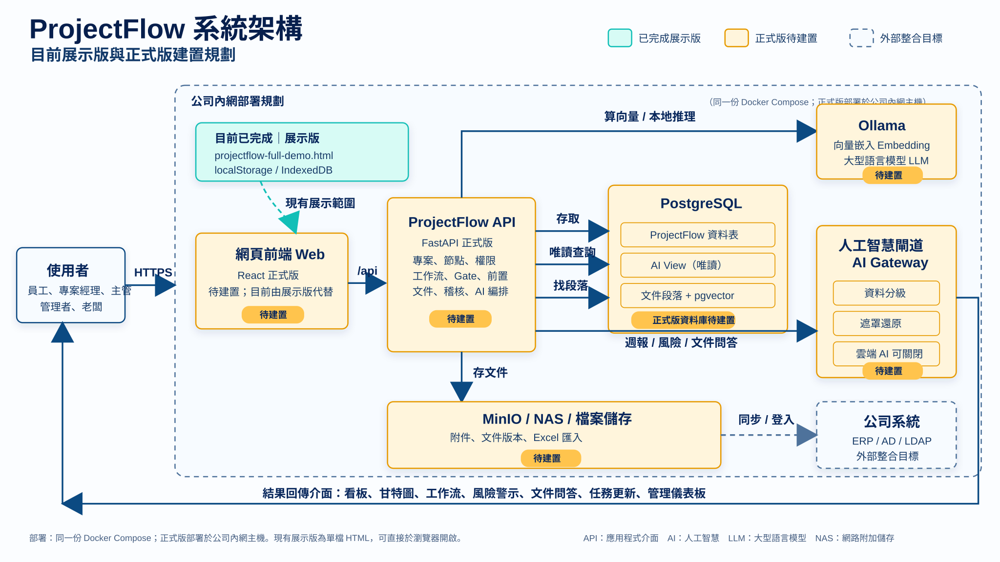

# 專流 ProjectFlow

> **2026-10-13 使用者頂欄與浮動副手（本機分支）**：右上角姓名選單保留公司／角色、切換公司與登出；右下角圖示開啟 AI 專案副手，收合保留同一頁的輸入與對話。專案的「另存為模板／套用模板／新增子節點」整合成顯示第一項操作的下拉選單，保留原權限。桌面／手機驗證通過，預覽15177；未推送或部署。[短規格與驗收](docs/superpowers/plans/2026-10-13-header-floating-actions.md)。

> **2026-10-13 本機介面更新**：捲軸捲動時顯示、閒置後隱藏；左側「專案」改為右側第二層面板，選取／外部點擊／Esc可關閉；看板、時程、相依圖等選中頁籤與下方內容同底色連接。桌面／手機驗證通過，保留在 `feature/ux-child-modules-navigation`，本次更新尚未推送或部署。[短規格與計畫](docs/superpowers/plans/2026-10-13-navigation-surface.md)。

> **2026-10-12 同網域試用**：執行`python deploy/start.py --lan`，同網路的人就能用`http://<這台電腦的IP>:15173`試用。只開放網頁，API與資料庫仍只在本機；管理員從區網登入後也能用左下「切換公司」。Windows防火牆要自己開；帳號、密碼與限制見[正式版開發指南](docs/formal-development.md#同網域試用lan-trial)。不加`--lan`重啟即關閉。這不是HTTPS或正式內網部署。

> **2026-10-12 展示資料包**：`deploy/demo-data/`是15173資料庫的去敏匯出（虛構展示資料，1758列）。不含登入session、稽核紀錄、通知與密碼雜湊。另一台電腦執行`python deploy/start.py`建立空環境後，以`python deploy/demo_data.py import`還原，帳號密碼為`demo-<帳號>`。只還原到同版本的空資料庫。重新匯出與限制見[資料包說明](deploy/demo-data/README.md)。

> **2026-10-12 正式採購退貨、工單退料與沖銷**：營運資料→採購→選紀錄→「採購操作」選「採購退貨」，從明細選品項、填退貨數量與原因後確認：扣庫存並扣回該列已收，未收數量恢復等待補貨（不補貨請調低訂購數量或結案），明細顯示已退；無明細的舊單可退回本單淨收貨內的數量。工單（食品為「試產／檢驗」）→「工單操作」選「退料回庫存」，從本工單已領物料選擇，數量不超過淨領料，退料加回庫存，累計領料改為淨額並顯示已退料。各頁「異動紀錄」的每筆收貨、退貨、領料、退料、完工、人工調整都可「沖銷此筆」：填原因後新增一筆數量相同、方向相反的沖銷流水，原紀錄保留並標示「已沖銷」，同步回復庫存、明細已收、計畫已完工與淨領料；每筆只能沖銷一次，沖銷紀錄不能再沖銷，結果會讓庫存或進度超出範圍時拒絕並說明。已結案的採購單或工單須先重新開啟才能退貨、退料或沖銷。管理角色操作，重送防重、併發不超退、同一筆不會被沖銷兩次。尚無退貨單號／金額、原因代碼、部分沖銷、自動補貨任務或批號。[範圍與驗收](docs/superpowers/plans/2026-10-12-f1-returns-reversals.md)。

> **2026-10-12 正式工單產量與狀態**：營運資料→工單（食品為「試產／檢驗」）→選紀錄→「設定生產計畫」，搜尋並選擇成品、填計畫產量／單位／備註後儲存。工單上顯示計畫／已完工／尚差，以及依物料彙總的累計領料。完工入庫改為選工單指定成品，可分批入庫，累計不得超過計畫產量（多產出請先調高計畫產量），單位須與計畫一致；領料仍手動、可分次。生產狀態由系統計算：未設定計畫／待生產／生產中／已達計畫產量／已結案，工單列表也會顯示；原「狀態」欄位仍為人工文字。可填原因人工結案（結案後禁止領料、完工與改計畫）或重新開啟。已有完工時不能更換成品或單位，計畫產量不可低於已完工。管理角色操作，重送防重、併發不超量。未設定計畫的舊工單照原方式自由入帳，設定計畫前的完工另列筆數不計入進度。尚無BOM自動扣料、退料沖銷、副產品／良率、批號、工時成本或完工後自動建立任務。[範圍與驗收](docs/superpowers/plans/2026-10-12-f1-work-output.md)。

> **2026-10-12 正式採購明細／部分收貨進度**：營運資料→採購→選紀錄→「建立採購明細」，逐列搜尋物料、填訂購數量／單位／備註後儲存。收貨改從明細選品項，畫面顯示每列訂購／已收／未收，可分批收貨；累計不得超收（多到貨請先調高訂購數量），單位須與明細一致。收貨狀態由系統計算：未建立明細／待收貨／部分收貨／已收齊／已結案，採購列表也會顯示；原「狀態」欄位仍為人工文字。可填原因人工結案（結案後禁止收貨與改明細）或重新開啟。已有收貨的明細不能刪除或改物料／單位，訂購量不可低於已收。管理角色操作，重送防重、併發不超收。舊採購單不從文字推算明細、仍可自由收貨，建立明細前的收貨另列筆數不計入進度。尚無單價／金額、逐列交期、退貨沖銷、自動驗收任務或一般角色查看進度。[範圍與驗收](docs/superpowers/plans/2026-10-12-f1-purchase-lines.md)。

> **2026-10-12 正式工單領料／完工入庫**：營運資料→工單（食品為「試產／檢驗」）→選紀錄→選「領料扣庫存」或「完工入庫」，搜尋物料／成品、填正數數量、單位與原因後確認。領料扣原料庫存、完工增加成品庫存；流水保存工單來源、前後餘額、操作人與時間，工單與物料兩處可查。成品先在物料／資源分類建立。管理角色操作，支援分次領料／分批完工，重送防重、庫存不足拒絕。生產計畫、產量進度與結案已另交付（見上方）；尚不依BOM自動扣料、不自動更新任務、不做批號／成本／退料流程。[範圍與驗收](docs/superpowers/plans/2026-10-12-f1-work-stock.md)。

> **2026-10-11 正式採購收貨／庫存**：管理者或專案負責人從「營運資料→採購→選紀錄」搜尋物料、填實收數量／單位／說明，確認收貨後增加庫存。「原料／包材（各產業資源分類）→選物料」可看餘額、以必填原因做正負盤點調整、查來源／數量／前後餘額／操作人與時間。整筆交易保存、操作UUID防重送、負庫存拒絕；數量3位小數、單位首次入帳後固定。首版單一公司庫存，管理角色查帳；無倉別、單位換算、成本會計或退貨；採購明細／收貨進度與工單領料／完工入庫已另交付（見上方）。舊自由文字與虛構示例不自動入庫，原「狀態」欄位仍人工維護。[範圍與驗收](docs/superpowers/plans/2026-10-11-f1-inventory.md)。

> **2026-10-11 正式資料關聯**：專案／任務「資料」→選分類、搜尋→「關聯並儲存」，可關聯同公司供應商、採購、工單，重新整理仍保留。點選已關聯紀錄查看最新內容；解除只移除連結，原營運紀錄保留。各節點分開保存，沿用節點編輯權限，機密資料依目前權限過濾。原紀錄新增／編輯仍在左側「營運資料」；本次不自動配對舊示例或同步任務狀態。[範圍與驗收](docs/superpowers/plans/2026-10-11-f1-links.md)。

> **2026-10-11 正式營運資料**：左側「營運資料」可依產業分類新增、編輯、搜尋及儲存紀錄，支援自訂詳細欄位。六公司94筆既有虛構營運資料已匯入並保留展示來源標示。管理者／專案負責人可維護資料；其他角色唯讀公司內部紀錄，機密紀錄僅管理角色可見。每次儲存記版本編號、修改人與時間，衝突保留草稿。狀態為人工紀錄；收貨／庫存已正式化（見上方），簽核、单據自動連動、ERP同步與批號追溯引擎尚未串接。「查看原展示示例」保留原預覽；專案「資料」已正式化（見上方）。[實作範圍](docs/superpowers/plans/2026-10-11-f1-operations.md)。

> **2026-10-11 正式文件管理**：專案／任務的「文件」分頁支援正式上傳、TXT／CSV文字編輯、儲存新版本與歷史下載。每版保留作者、時間、說明與原始檔案；同時編輯衝突不覆蓋舊版。單檔10MB，網頁文字編輯1MB；Word／Excel／PDF等下載修改後再「上傳新版本」。專案層文件由管理者／專案負責人維護，任務文件沿用紀錄權限。原資料／營運示例保留於明確預覽入口（正式入口見上方）；完整文件簽核、Office網頁編輯與版本還原不在本次範圍。[文件管理計畫](docs/superpowers/plans/2026-10-11-f1-documents.md)。

> **2026-10-11 AI助手更新**：已加入六公司AI展示資料區、文件檢索與原文引用、16種受控Text-to-SQL分析，以及另一台內網電腦的Ollama設定入口。模型未設定時可直接查文件與資料表；AI延伸專案與正式任務分開。操作與限制見[AI助手說明](docs/ai-assistant.md)。

> 以「專案」為核心的 AI 工作流工具。參考 Notion 的彈性，但不是個人筆記，而是把**階段、多層任務、前置條件、權限、文件、AI 副手，以及供應商、配方、採購、工單等研發營運資料**綁在同一個專案裡，並且**部署在公司內網，資料不外流**。

目前的 Demo 包含**寵物食品、電子製造、活動行銷、軟體服務與營建工程**五個公司空間，以產業專案與工作流示範驗證介面與核心互動：

- `projectflow-petfood-demo.html`：階段 0 的原始 Demo
- `projectflow-full-demo.html`：依本文件 F1–F11 規格製作的完整互動 Demo（多層任務樹、時程編輯、前置條件與關鍵路徑、部門與權限、覆寫審核、任務模板、工作流模板／專案建立／階段關卡、AI 分級路由與遮罩、研發營運資料與模擬 ERP、任務完成回報／筆記／附件、主管跳過任務）。資料存在瀏覽器 localStorage，附件存在 IndexedDB，左下角可切換身分體驗權限差異，也可重置資料。

---

## 協作者分支：時程互動改善（2026-10-12，未合併）

`feature/ux-child-modules-navigation` 改善子任務新增／日期拖曳、停用原因、原畫面保留與層級提示，並修正左側專案清單被壓縮遮蔽：選單統一捲動、長名稱完整換行；既有公司及角色權限不變。已核對展示資料包的80帳戶／39專案，並完成桌面／手機驗證。完整結果、限制與其他改善建議見 [UI／UX 檢查報告](docs/ux-child-review.md)。此功能分支依協作者要求送交原儲存庫 PR 審閱，尚未合併或部署。

## 給接手的人：怎麼請 AI 繼續開發

這個專案的開發進度、流程和決策都寫在 repo 裡，任何 AI 都可以照文件接手，不需要靠對話記憶。

- 進度看板：[docs/PROGRESS.md](docs/PROGRESS.md)
- 流程：[docs/WORKFLOW.md](docs/WORKFLOW.md)
- AI 入口：[AGENTS.md](AGENTS.md)

### 目前進度（2026-10-08 更新）

> 這一段是給組員的摘要。最新、最完整的狀態以 [docs/PROGRESS.md](docs/PROGRESS.md) 的「▶ 現在」為準。
>
> **2026-10-05 起改成「展示模式」**（PROGRESS D30）：這個 Demo 是展示用的，以主要功能能用為主，不花時間在細節修飾。流程照 [WORKFLOW §13](docs/WORKFLOW.md#13-展示模式人類-2026-10-05-指示progress-d30) 精簡，W4 取消，W3、W5 縮小範圍。

| 工作項目 | 狀態 | 說明 |
|---|---|---|
| W1 子任務置頂回報卡 | ✅ 完成 | 已合併進 `main` |
| W2 部門模型 | ✅ 完成 | 已合併進 `main`，包含 10 部門、負責部門、可見性／操作權限、時間軸部門篩選、模板帶入負責部門 |
| W3 工作流架構（精簡版） | ✅ 完成 | 已合併進 `main`，包含工作流模板 CRUD、從工作流建立專案、階段關卡擋住後續階段。個別工作流內容之後由使用者自行添加 |
| W4 F11 遺留問題清理 | ✖ 取消 | 展示模式下不做（D30） |
| W5 README 對齊現況 | ✅ 完成 | §1 快速開始和 §2 功能總覽已對齊 full demo 現況（D30） |
| W6 多公司產業範例 | ✅ 完成並發布 | 已合併並推送 GitHub `main`：五個公司空間、產業工作流與營運模組、v6 遷移、獨立附件與單公司重設 |
| P0 正式版骨架 | ✅ 完成並發布GitHub main | API 8項、React 6項、Playwright 4項及build通過；Docker／PostgreSQL中斷恢復、桌面／手機驗收通過。[正式版開發](docs/formal-development.md)、[P0計畫](docs/superpowers/plans/2026-10-08-p0-formal-foundation.md) |
| P1a 正式版後端核心 | ✅ 完成並發布GitHub main | 登入/session、公司隔離、P1a migration與seed、Project／Node／Department／Workflow／Gate／Report／Audit API完成；API 35項、Vitest 6項、Playwright 4項、build與真PostgreSQL migration／seed smoke通過。[P1a計畫](docs/superpowers/plans/2026-10-08-p1a-backend-core.md) |
| P1b → P1c 正式版MVP | 本機工程交付與自動驗收通過；人類試用待簽核 | 登入、節點／看板、工作流／閘門、角色隔離、一鍵啟動與隔離驗收命令已實作；逐Task及整體獨立審查通過。[試用清單](docs/mvp-trial-checklist.md) |
| P2a 完整任務工作區 | ✅ 工程交付完成；人類試用待簽核 | 總覽、我的任務、多層節點、新增／編輯、指派、可空日期與深層Gate已實作；六Task與G4獨立審查、main隔離回歸及本機部署通過；發布紀錄見PROGRESS。[P2a規格](docs/superpowers/specs/2026-10-08-p2a-task-workspace-design.md) |
| P2b 回報與協作 | ✅ 工程交付完成；人類試用待簽核 | 八Task TDD與雙獨立審查、G4／main隔離回歸通過；回報送審／退回／確認、筆記、指定協作、持久附件、審核中心與安全稽核已部署至15173，保留既有資料。 |
| P2c 時程／模板／前置精簡版 | ✅ 工程交付完成；人類試用待簽核 | 日／週／月時程、日期改期、模板管理與硬性FS前置；依D65／D66A精簡範圍，非完整Demo移植。 |

**目前做到哪裡**

- Demo 驗證軌的主要功能架構已完成：F1–F11、W1、W2、W3、W6；團隊以本倉庫 `main` 的 README 與進度看板為準。
- 目前測試基準：`tests/records.html` 為 `全部通過 174/174`（W6：既有 149 項加 25 項公司測試）。
- W3 依 2026-10-05 人類指示改成「先完成功能架構」：系統支援工作流模板、從工作流建立專案、階段關卡；每個部門的實際工作流內容可由使用者之後自行添加。
- Demo 走查已通過；最後只等人類確認可以拿來展示，以及決定 D43（工作流編輯器是否要做成表單式，不擋展示）。
- 正式版P0至P1c本機MVP工程交付與自動驗收已通過，提供可重複執行的隔離驗收命令。API 80項、Vitest 56項、Playwright 6項與build通過，逐Task及整體獨立審查完成，見[試用清單](docs/mvp-trial-checklist.md)。P2a已依D56完成：API182項、Vitest96項、Playwright9項及build通過，真PostgreSQL升級保留資料與隔離重啟驗證通過；人類試用簽核仍未完成。P2b依D59–D64完成工程交付：強制PostgreSQL遷移1項及並行競態3項、API337項（另5項條件skip）、Vitest150項、Playwright13項與build通過；既有資料保留升級及附件持久化／故障恢復通過，人類試用仍待簽核；P2c時程／模板／硬性FS精簡範圍已工程交付並保留資料部署至15173，驗收首次失敗及窄修正結果如實見PROGRESS；其餘P2c延後範圍、P2d與LAN／正式部署仍未交付。
- 本機入口：[正式版](http://127.0.0.1:15173)，P2a已部署並提供總覽／我的任務／專案工作區，其他組員照[正式版開發指南](docs/formal-development.md)啟動自己的環境。以food公司的yu／demo-yu登入，可瀏覽專案、更新狀態、核准閘門及從模板建立專案；chen／ming／lin種子帳號與角色見開發指南。HttpOnly cookie識別公司，登入後沒有前端公司切換。P2a新增管理者建節點／改派、可見執行者編輯名稱日期，以及可見任務完成率done／(task−skipped)，分母0顯示「—」；日期可空；P2c新增時程拖曳與日期表單，正式部署狀態見PROGRESS。真AI／ERP／AD／完整RAG不在本輪MVP，不能用Demo驗收代替正式版驗收。

**UI1（D67）**：[前端介面對齊](docs/superpowers/plans/2026-10-09-ui1-demo-alignment.md)已完成側欄、配色、字級間距、總覽與任務卡片、工作區及時程／管理頁；接既有真API，桌面／手機隔離驗收與獨立審查完成，15173已更新新版前端並保留原資料，詳細結果見PROGRESS。P2d文件／營運／摘要排在其後，尚未交付；人類試用待簽核。

**UI2（D68）**：[產業模板與本機展示切換](docs/superpowers/plans/2026-10-09-ui2-showcase-library.md)已交付至15173。12套食品／電子／活動／軟體／工程範本可分類、搜尋、預覽並加入公司模板，接既有建立專案流程。左下可切換五家公司，明確標示展示管理者；正式環境預設關閉，本機已依授權開啟，原資料保留。

**既有展示專案已補齊（2026-10-09）**：成貓主食罐現在5階段／17任務，連接器5階段／14任務，新增建議日期、Gate與前置相依；保留原內容與進度，依人類要求移除空白waa專案。重新整理15173即可查看。

**展示進行情境已加入**：主食罐2完成／1進行／1待審，連接器3完成／1進行／1待審；含8份回報、4筆筆記、退回重送、Gate與前置阻擋。新增紀錄均標「展示情境」，管理者可直接試審核。

**全部模板展示已補齊**：目前15套模板（含原模板與複本）各有進行中的專案：食品4／電子4／活動3／軟體2／工程2，共188項任務，含完成、進行中、待審、前置阻擋、回報與筆記。切換五家公司即可展示；原有資料保留。

**後續優先順序已重排（D69，順序已由下方D70修訂）**：先做到與Demo相同的畫面與操作體驗，功能逐步補。**UI3框架／首頁 → UI4工作區／操作 → UI5其餘Demo畫面 → F1逐頁補正式功能 → F2進階能力**。原P2d拆入後續，不先做大型後端擴充。以同尺寸截圖與操作路徑驗收，畫面對齊與正式功能分開記錄；這次僅完成[重新規劃](docs/superpowers/plans/2026-10-09-demo-parity-first.md)，未實作UI3、未改15173。

**其餘五公司完整展示資料已補齊（2026-10-11）**：毛研食品、峰曜科技、光點企劃、雲序軟體、築衡工程各追加6部門、10位具名人員、4專案、26任務及16份回報，保留所有舊資料與禾沐。共20新專案／130任務／80回報，可操作審核、退回、排程及前置阻擋。「營運資料」各有公司概況、合作單位、產業資源、3筆單據、2筆執行紀錄、5份文件與明確關聯；所有內容為虛構案例，單據操作／文件編輯仍是暫存預覽，沒有ERP或新AI串接。原食品UI5示例可由「查看原食品試產示例」進入。完整資料快照保存在新增專案根層紀錄。重新整理15173後切換公司，新增專案以「【虛構展示】MY／FY／GD／YS／ZH」識別。專用匯入`deploy/populate_industries.py`預設dry-run、五公司單一交易、碰撞拒絕、重跑保留使用者修改；不用通用seed。

**禾沐食品公司資料已加入（2026-10-11）**：15173重新整理後，在左下「切換公司（本機展示）」選「禾沐寵物營養股份有限公司」。新增獨立公司，不改原五公司：8部門、12位具名人員＋展示管理者、4專案、25任務、16相依、10回報；可編輯任務、排程、審核／退回。公司共42人是虛構規模，非建立42帳號；進度由系統實算，非概念稿百分比。「營運資料」提供7合作單位、8料項、3採購、1工單及5文件預覽；完整資料快照另存各專案根層紀錄筆記。文件編輯與模擬收貨只暫存，不是營運CRUD；新公司AI尚無專屬回答，不讀取正式資料。全部為虛構案例。匯入工具`deploy/populate_hemu.py`預設dry-run，重跑不覆蓋修改，不執行通用seed。驗證／備份紀錄見PROGRESS。

**UI5已交付（2026-10-11，D80／D81）**：本機[15173](http://127.0.0.1:15173)已提供食品案例的文件版本／文字編輯預覽、關聯資料、七分頁營運，以及六快捷／輸入對話／建議套用的AI副手。任務與回報審核仍是真功能；新增畫面明示「展示預覽」，僅存記憶體，不寫正式資料，不連模型或ERP。其他公司顯示明確空狀態。[短展示步驟](docs/formal-development.md#ui5-展示操作2026-10-11)。build、91項相關Vitest、1280／375展示E2E、既有回報審核冒煙與獨立審查通過；詳細真實紀錄見[PROGRESS](docs/PROGRESS.md)。人類試用未代簽；展示目標達成後停止，不自動開始F1／F2。

**TP-G（D79）自訂回報欄位**：任務編輯器支援文字、數字、日期、單選、必填與排序；回報與審核保存歷史快照，退回重報可帶回值。模板版本、建立專案、套用及複製子樹帶定義，不帶回報值。欄位設定分開儲存，無權限或待審／關閉時不可改；改版衝突保留輸入，過期覆寫申請可重送。驗收與保值部署紀錄見PROGRESS；人類試用未代簽。UI5展示畫面亦已交付（見上方）。[短計畫](docs/superpowers/plans/2026-10-10-tp-g-report-fields.md)。

**任務規劃器優先（D70）**：先讓任務規劃器的功能跟Demo一樣，文件、營運與AI排在後面。順序改為**UI3 → UI4 → TP-A至TP-G任務規劃器功能補齊 → UI5 → F1 → F2**。TP涵蓋任務樹與看板、樹狀編輯、時程進階、前置進階、模板、權限與協作、自訂回報欄位；文件不算在內，復原只做上一步。各批範圍見[D70規劃](docs/superpowers/plans/2026-10-09-demo-parity-first.md#d70任務規劃器優先)。

**UI3（D69／D70）**：[Demo框架與首頁對齊](docs/superpowers/plans/2026-10-09-ui3-frame-home.md)已交付。桌面是Demo的三區（側欄252｜主區｜AI副手350，1280／1440寬度與Demo相同），導覽名稱、圖示、側欄專案進度與「＋ 建立新專案」照Demo；總覽改成Demo的統計卡、專案表（目前階段、完成度、預計完成、延遲、待確認）與人員／部門負載；我的任務改成「我負責的／我協作的」分組表格。平板與手機用左右抽屜。AI副手目前只是標示「展示預覽」的位置，營運資料與AI政策標示「尚未提供」；延後天數預測、待我指派與通知在TP-C／TP-F。下一步UI4（工作區與操作）。

**UI4（D70／D72）**：[專案工作區與操作對齊](docs/superpowers/plans/2026-10-09-ui4-workspace-ops.md)已交付。專案頁照Demo：麵包屑、目前節點標題與meta列（負責、期間、完成率、狀態）、右側操作、專案層階段條（完成率與閘門狀態）、階段層閘門列，分頁「看板・時程・相依圖・文件・資料・成員與權限・紀錄」；主區節點樹移除，往下點看板卡片或階段條、往上點麵包屑。看板4欄（1280每欄與Demo同寬148），子任務預設打開紀錄，回報卡收合、按「回報完成」才展開；成員與權限分頁列出你在此節點可做的事。時程改日／週／月分段鈕與Demo密度，手機同一張圖框內橫捲；相依圖改成由左到右的任務方塊與直角箭頭；模板庫卡片可直接「用這套工作流建立專案」；審核中心分區並以表格列出待核准閘門。沒有新API或資料變更；另存／套用模板、文件、資料、跳過申請、拖曳改狀態、節點自己的時程／相依圖仍標「尚未提供」，排在TP-A至TP-G、UI5／F1。下一步TP-A（任務規劃器：節點分頁、看板拖曳與卡片資訊、進度彙總）。

**TP-A（D70／D73）**：[節點分頁、看板拖曳、卡片資訊與進度彙總](docs/superpowers/plans/2026-10-10-tp-a-board-progress.md)已交付。看板可以拖曳卡片改狀態：拖到待處理／進行中走既有狀態規則，拖到待確認或完成會打開完成回報，不會略過回報。系統管理員與專案負責人可以把卡片拖到另一張待處理或進行中的卡片上，變成它的子任務（新API `POST /nodes/{id}/move`；擋下移到自己底下、已完成／待確認／已略過的目標，以及會和前置相依衝突的移動；稽核記「移動節點」）。卡片顯示子任務數、迷你進度、卡片內展開下一層、「✓ 回報」、「等待：前置名稱」，滑過卡片會高亮相關前置與後續。進度改為加權彙總：葉任務待處理0／進行中50或手填／待確認90／完成與略過100，上層是看得到的子節點的加權平均（權重預設1，可在編輯節點改成0–100整數）；標題、階段條、卡片、時程上層條、側欄與總覽專案表都用這個進度，總覽第4張卡仍是可見任務完成率。子節點沒有全部完成或略過時，上層不能改完成，也不能送出或確認完成回報（API強制，不揭露看不到的子節點）。時程、相依圖、紀錄改成目前節點的範圍，時程有「↑ 上一層」，專案層紀錄是整個專案的唯讀彙總（`GET /projects/{id}/records`）。migration `20261010_0005`新增`nodes.weight`、`nodes.progress`，既有資料只多預設值。和Demo刻意不同的地方：拖到完成仍走回報、移動不刪相依、只算看得到的節點、還沒有附理由覆寫（TP-F）與上層狀態自動連動。下一步TP-B（刪除、升降級、拖曳改層級、複製子樹、復原上一步）。

**TP-B（D70／D74）**：[樹狀編輯：刪除、升降級、移動、複製子樹與復原](docs/superpowers/plans/2026-10-10-tp-b-tree-editing.md)已交付。「編輯節點」表單照Demo加「層級操作」：↖ 升級（移到上上層，模板專案的階段內任務會移到專案最上層）、↘ 降級（放進上方前一個同層節點）、「移動到…」下拉（手機與鍵盤不用拖曳也能移動）、「複製子樹」，以及左下角紅色「刪除」。刪除先顯示確認：會一併刪除幾個子任務、哪些後續任務的前置會被移除；刪除做成軟刪除（migration `20261010_0006`新增`nodes.deleted_at`、`deleted_by`），回報、筆記、附件與稽核都保留，只是所有畫面與API都看不到，稽核頁仍列出歷史並標「（已刪除）」。複製會在原任務後面建一份「（複本）」，帶負責人、部門、日期、權重、協作設定與子樹內的前置，狀態一律待處理，不複製回報、筆記、附件。新增節點、刪除、移動（含看板拖進卡片）、複製之後，提示列有「復原」，時程工具列有「↶ 復原」，也可以按Ctrl+Z；只能復原自己最近一次的結構操作、只有一步，之後有人動過就會擋下並說明（新API `POST /undo`）。權限依D74照Demo放寬：任務負責人與部門主管也能升降級、移動自己的任務；複製與刪除只限系統管理員與專案負責人。上層已完成、待確認或已略過時，不能在底下新增、移入、複製、重新開啟或恢復子任務，要先重新開啟上層（併入TP-A後續Minor 1）。和Demo刻意不同：階段不能複製或刪除、複製只限管理者、刪除是軟刪除、上層不自動改回進行中、復原只涵蓋結構操作。後續時程進階見TP-C。

**TP-C（D70／D75）**：[時程進階](docs/superpowers/plans/2026-10-10-tp-c-advanced-timeline.md)已交付。父條涵蓋自身與可見子孫期間，負責部門篩選保留匹配路徑；每列「＋」與底部空白軌拖曳可新增子任務，葉任務可左右拉伸。編輯器可設單日里程碑與鎖定，圖上顯示菱形、鎖頭與延遲提示。勾選「後續相依自動順延」才連動FS後續；逐項檢查權限，遇鎖定、無權修改、未排程或已結束任務時整次取消，不會部分改期。時程新增前置箭頭與關鍵路徑按鈕；關鍵路徑是可見範圍的最晚結束單條限制鏈估算，非完整CPM。migration `20261010_0007`只新增里程碑及鎖定欄位，既有值為false；日期API `POST /nodes/{id}/schedule`與既有編輯API共用保護，逐節點留稽核。和Demo刻意不同：順延預設關、遇阻全數取消、鎖定限管理者、日期不復原、只顯示可見資料。不含ERP交期、首頁延後天數預測、完整CPM；下一步TP-D（SS／FF、延遲天數、軟性／條件型前置、相依圖拖線建立）。

**TP-D（D70／D76）**：[前置進階](docs/superpowers/plans/2026-10-10-tp-d-advanced-dependencies.md)已交付，本機15173已更新，既有資料保留。相依圖可拖線開啟確認表單，選FS／SS／FF、-365至365天延遲與硬性／軟性，既有連線可編輯。軟性前置只警示；FF在自行確認或審核核准時檢查。條件型先採管理者人工確認／撤回，必填理由並留稽核，尚未串接ERP或文件核准。時程順延與關鍵鏈支援硬性三種類型及延遲，保留D75遇阻整筆回滾。migration `20261010_0008`保留舊連線為FS／0／hard；複製保留連線設定，人工條件重設未確認。TP-E接續完成模板進階。

**TP-E（D70／D77）**：模板進階支援任務／階段子樹另存、專案另存工作流、模板完整版本與選版套用、軟刪除。從節點標題列開啟「另存為模板」或「套用模板」；套用只追加、保留既有任務，可復原上一步。公司模板由管理者維護，來源／目標另檢查專案管理權；負責人／協作預設不帶，人工條件重新確認。模板庫可查看版本與刪除，已建立任務不連動；階段另存任務模板轉普通根任務，完整工作流只套專案。保留FS／SS／FF、lag、soft、權重與里程碑；含里程碑必須帶入日期。migration `20261010_0009`為既有模板補v1完整快照，不重建專案。個人發布、搜尋過去任務直接套用、版本比較／回退、文件與自訂回報欄位仍未提供；下一批TP-F權限與協作。詳見[短計畫](docs/superpowers/plans/2026-10-10-tp-e-advanced-templates.md)。

**TP-F（D70／D78）**：權限與協作新增跳過／覆寫申請、主管核准與退回、子樹跳過及快照恢復。管理者可附理由直接操作；前置覆寫只放行當次，完成仍須交回報，非管理者可申請覆寫送出回報。失效申請結案，恢復不覆蓋後續修改。管理員可維護部門成員與主管；主管可見並指派本部門任務，「我的任務」新增待我指派及個人通知，支援已讀。成員權限頁與人員／部門負載明細使用可見資料。migration `20261010_0010`只新增申請證據及通知表，不重建既有資料。通知為站內通知，無Email／推播；下一批TP-G自訂回報欄位。詳見[短計畫](docs/superpowers/plans/2026-10-10-tp-f-permissions-collaboration.md)。


**精簡流程（2026-10-09，D65）**：後續以Demo主要展示流程為目標，每階段短規格／計畫、一次獨立審查、一次完整回歸；修正只重驗受影響部分，一般畫面不強制TDD。保留既有資料、隔離測試與基本權限，已完成功能不重做。詳見[工作流程 §14](docs/WORKFLOW.md#14-精簡流程d65)。

**階段發布規則（2026-10-08，D50）**：每完成一段工作，先更新本 README 的「已完成／目前階段／下一步」與 PROGRESS，通過該段驗證及審查後合併並推送 GitHub `main`。規劃草稿與已實作功能分開標示，不把未執行測試寫成通過。

**和 plan 不同、已由人類決定的地方**：PROGRESS §6 的 D19–D33，以及 §3 W2「執行注意」第 20–34 點。例如 D23：任務的時程只有負責人、負責部門主管、專案負責人和系統管理員能改。接手前請先讀這些條目，不要照 plan 的舊寫法改回去。

**組員怎麼接著做**

1. 取得最新 `main`：
   ```bash
   git fetch origin
   git checkout main
   git pull --ff-only origin main
   ```
2. 照下面「用 Claude Code」或「用其他 AI」的方式開新的 session。AI 會讀 PROGRESS「▶ 現在」，確認下一步是展示驗收、結案摘要，或等人類決定正式產品軌。
3. 之後若要新增工作流內容，可以直接在 Demo 的工作流模板庫新增／複製／編輯；若要繼續開發新功能，再依 PROGRESS 新增工作項目。

### 用 Claude Code（建議）

在專案資料夾開一個**新的** session，輸入下面的指令：

| 想做什麼 | 輸入 |
|---|---|
| 看現在的狀況（不改 repo） | `/pf-status` |
| 往前推進一步（開工、做完一個 Task、整體審查或合併） | `/pf-next` |
| 一路做到目前的工作項目完成並合併，遇到要人類決定的事就停下來 | `/pf-next all` |
| 只預覽下一步（不改 repo） | `/pf-next dry` |

第一次建議先跑 `/pf-status`，確認它讀到的下一步和 PROGRESS「▶ 現在」一致，再跑 `/pf-next`。

### 用其他 AI（Codex、Gemini、Cursor 等）

開場貼這段：

```text
請先讀 AGENTS.md，照「開工三步」做：看 docs/PROGRESS.md 的「▶ 現在」，照 docs/WORKFLOW.md 推進下一步。
先讀 PROGRESS §3 目前工作項目的「執行注意」，照該項目的 plan 一個 Task 一個 Task 做。
每個 Task 做完都要更新 PROGRESS 並 commit；遇到 AGENTS.md §5 列的情況就停下來問我。
```

### AI 什麼時候會停下來問你

- **需要人類決定的時候**：例如 plan 或 spec 和程式碼衝突、出現 spec 沒寫明的產品決定，或要寫新的 spec。AI 會先在 PROGRESS §6 登記一個 D 編號，再來問你。
- **怎麼回答**：直接講結論就好，例如「D7 照建議」「D19 維持現狀」。AI 會把結論記進看板，然後繼續做。
- **展示模式下的小細節**：spec 沒寫到的小地方，AI 會自己照建議做，在 PROGRESS §6 記成「AI 代決（可推翻）」，不停下來等你（D32）。想改就直接說「Dn 改成…」。
- **push、PR，或合併無法 fast-forward**：每次都要你明確指示。例如說「做完推上 git」，AI 才會 push。
- **想一次處理待決定事項**：可以說「列出 PROGRESS §6 待人類的 D，一個一個問我」。

### 注意事項

- **測試會清掉 Demo 資料**：AI 跑測試時用的是 `http://127.0.0.1:…`，會清掉那個網址下的 Demo 資料和附件。你自己試用 Demo 時請開 `http://localhost:8000/…`，這樣資料不會被清到。
- **8000 埠的伺服器**：AI 會先確認 8000 埠上的伺服器是不是這個 repo，不是的話會改用其他埠（例如 8001），不會去動別人的伺服器。
- **直接下的指示優先**：你在對話中直接下的指示優先於看板。AI 會先把指示寫進 PROGRESS，再照做。

---

## 目錄

- [給接手的人：怎麼請 AI 繼續開發](#給接手的人怎麼請-ai-繼續開發)
1. [快速開始](#1-快速開始)
2. [Demo 功能總覽](#2-demo-功能總覽)
3. [核心概念](#3-核心概念)
4. [功能規格](#4-功能規格)
   - [F1 多層任務樹](#f1-多層任務樹)
   - [F2 任務模板](#f2-任務模板)
   - [F3 時程編輯](#f3-時程編輯)
   - [F4 前置條件與相依連線](#f4-前置條件與相依連線)
   - [F5 權限與覆寫審核](#f5-權限與覆寫審核)
   - [F6 協作單位與人員](#f6-協作單位與人員)
   - [F7 內網部署與文件儲存](#f7-內網部署與文件儲存)
   - [F8 AI 專案副手](#f8-ai-專案副手)
   - [F9 資料分級與 AI 路由](#f9-資料分級與-ai-路由)
   - [F10 研發營運資料（供應商、原料、配方、採購、工單）](#f10-研發營運資料供應商原料配方採購工單)
   - [F11 任務紀錄與完成回報](#f11-任務紀錄與完成回報)
5. [資料模型](#5-資料模型)
6. [系統架構](#6-系統架構)
7. [專案結構](#7-專案結構)
8. [開發路線圖（各階段該完成的事）](#8-開發路線圖各階段該完成的事)
9. [待決定事項](#9-待決定事項)
10. [附錄：寵物罐頭開發階段範本](#10-附錄寵物罐頭開發階段範本)

---

## 1. 快速開始

### 正式版本機 MVP

需要Python 3.13、Docker Desktop（Linux容器／Compose）。從repo根目錄初次明確初始化示範帳號：

```powershell
python deploy/start.py --seed-demo
```

開啟[正式版本機入口](http://127.0.0.1:15173)，以公司 `food`、帳號 `yu`、密碼 `demo-yu` 登入。已有資料的環境只用 `python deploy/start.py` 重啟，不加seed。設定與PostgreSQL volume會保留；不要刪除volume或重產已有密碼。

開發者先依[正式版開發指南](docs/formal-development.md)安裝鎖版API／Web測試依賴，再執行：

```powershell
api/.venv/Scripts/python.exe deploy/verify.py --keep-running
```

此命令依序啟動獨立 `projectflow-acceptance`、先跑專用PostgreSQL遷移與並行驗收，再跑API／Vitest／build／E2E，預設入口為15175，不向共享15173寫入測試專案。拿掉 `--keep-running` 會在結束後停止驗收服務，但保留驗收DB與files兩個volume。失敗會回傳非零exit code；詳見[試用驗收清單](docs/mvp-trial-checklist.md)。目前只交付loopback本機MVP；P2b新增回報／審核／筆記／附件／協作／稽核介面，正式發布狀態以PROGRESS為準；真AI、ERP、AD、LAN正式部署不在本輪範圍，人類試用簽核仍待完成。

### 獨立 Demo

Demo 是單一 HTML 檔，不需要安裝任何套件。現在請以 `projectflow-full-demo.html` 為準；`projectflow-petfood-demo.html` 是階段 0 存檔。

左下角先選公司，再選身分。五家公司資料獨立；切換公司時回到該公司的預設專案負責人，重新整理則保留目前公司與身分。「重設目前公司」只重建所選公司，其他公司的資料與附件保留。

```bash
# 直接用瀏覽器開啟
start projectflow-full-demo.html        # Windows
open projectflow-full-demo.html         # macOS

# 或起一個本機伺服器
python -m http.server 8000
# Demo：  http://localhost:8000/projectflow-full-demo.html
# 測試：  http://127.0.0.1:8000/tests/records.html?t=任意時間戳
```

> 字型從 Google Fonts 載入，離線時會退回系統字型（微軟正黑體 / 蘋方）。正式版會改為本地字型，以符合內網環境。

---

## 2. Demo 功能總覽

畫面分成三欄：**側邊欄（專案清單）｜主區（專案內容）｜AI 專案副手**。

| 區塊 | 功能 | Demo 狀態 |
|---|---|---|
| 側邊欄 | 專案清單、完成度、公司切換（身分選單上方）、身分切換、只重設目前公司、跨專案入口 | ✅ 可用 |
| 公司空間 | 毛研食品、峰曜科技、光點企劃、雲序軟體、築衡工程；各有獨立成員、部門、專案、工作流、營運資料、稽核與附件 | ✅ 可用 |
| 專案／節點 | 專案、階段、任務、子任務都是節點；每層都有看板、時程、文件、資料、成員、紀錄 | ✅ 可用 |
| 看板 | 四欄看板、拖曳改狀態、拖入子任務、卡片顯示前置、回報、負責人與負責部門 | ✅ 可用 |
| 時程 | 可拖曳／拉伸、關鍵路徑、前置箭頭、專案總覽預設收合成階段、依負責部門篩選 | ✅ 可用 |
| 前置與關卡 | FS／SS／FF、hard／soft、條件型前置、跳過申請／覆寫；工作流專案的前序階段關卡會擋後續階段 | ✅ 可用 |
| 模板庫 | 任務模板套用／另存；工作流模板新增、編輯、複製、刪除；可從工作流建立專案 | ✅ 可用 |
| 部門與權限 | 各產業 9–10 部門、部門管理、任務負責部門、未指派負責人、可見性與 `canWork` 操作權限 | ✅ 可用 |
| 我的任務／審核中心 | 我的任務、待我指派、跳過申請、階段閘門與配方簽核 | ✅ 可用 |
| 文件與紀錄 | 文件版本、完成回報、自訂欄位、筆記、附件 IndexedDB、稽核紀錄 | ✅ 可用 |
| AI 副手 | 規則式風險提醒、週報、任務拆解、會議待辦、成本比較；AI 分級路由與遮罩為前端模擬 | 🟡 Demo 模擬 |
| 營運資料 | 毛研保留完整配方、採購、工單、追溯與模擬 ERP；其餘產業各有六個專屬模組，支援詳情、欄位權限、狀態推進與專案條件連動 | ✅ 可用 |
| 後端／正式部署 | 目前仍是單檔 localStorage／IndexedDB Demo，正式產品軌尚未啟動 | 🟡 未接後端 |

**已知限制**：五家公司是固定的 Demo 空間，不提供公司新增／刪除／改名、登入隔離或後端多租戶。資料仍存在瀏覽器 localStorage／IndexedDB；AI、ERP、登入與權限執行都是前端模擬；沒有後端、多人同步或真正內網部署。正式產品軌尚未啟動。

---

## 3. 核心概念

### 3.1 一切都是「節點」

專案、階段、任務、子任務在系統裡都是同一種東西：**節點（Node）**。每個節點都有：

- 進度條（由子節點彙總）
- 看板、時程、文件三個分頁
- 負責人、協作人員、協作部門
- 前置條件
- 權限設定（預設繼承上層）

因此「點進任何一個任務」看到的畫面，都跟「點進專案」一樣，只是範圍變小。

```text
成貓主食罐・鮪魚雞肉（專案）
├─ 殺菌與保存（階段）
│   ├─ 殺菌條件驗證（任務）
│   │   ├─ 第 1 次 F0 測試（子任務）
│   │   ├─ 調整殺菌時間（子任務）
│   │   │   ├─ 設備參數設定（孫任務）
│   │   │   └─ 品保確認（孫任務）
│   │   └─ 第 2 次 F0 測試（子任務）
│   └─ 加速保存試驗（任務）
└─ …
```

### 3.2 閘門（Gate）

「前置條件」決定一個節點**能不能開始**；「階段閘門」決定**能不能進下一階段**。兩者都能被有權限的人**覆寫（跳過）**，但必須留下理由與紀錄。

---

## 4. 功能規格

### F1 多層任務樹

**需求**：任務可以無限往下拆，每一層都有進度條與看板 / 時程 / 文件。

| 項目 | 規格 |
|---|---|
| 層數 | 不限；介面建議超過 5 層時提示是否拆成獨立專案 |
| 進度計算 | 葉節點：待辦 0%／進行中 50%（或手動填寫）／審核中 90%／完成 100%；父節點：子節點加權平均（權重預設 1，可調） |
| 看板 | 卡片顯示子任務數量與迷你進度條；點「展開」在卡片內列出下一層；點進卡片則進入該節點的完整看板 |
| 時程 | 樹狀甘特圖，可展開 / 收合；父節點的時間條自動涵蓋所有子節點範圍 |
| 文件 | 每個節點有自己的文件區；上層可切換「只看本層」或「含所有子層」 |
| 導覽 | 頂部麵包屑（專案 / 階段 / 任務 / 子任務），可隨時跳回任一層 |
| 操作 | 拖曳改變層級（拉進另一個任務底下 = 變成子任務）、升級 / 降級、複製整棵子樹 |
| 狀態規則 | 子節點未全部完成時，父節點不能標為完成（有覆寫權限者除外） |

### F2 任務模板

**需求**：新增任務時可以套用「過去的任務」或「預設模板」。

- **來源**
  - 預設模板庫：系統內建（例：送驗流程、試作流程、供應商評估）
  - 組織模板：管理員發布，全公司可用
  - 從既有任務另存：任一節點（含整棵子樹）可「另存為模板」
  - 直接複製：新增時搜尋過去的任務，一鍵複製
- **套用時可勾選要帶入的內容**：子任務結構、前置條件、預設負責人 / 協作部門、檢查清單、文件範本、工期
- **日期處理**：模板存「相對時間」（例：開始後第 3 天、工期 5 天），套用時依新的開始日自動計算
- **變數**：模板內可用 `{產品名}`、`{負責人}` 等變數，套用時填入
- **版本**：模板修改後保留版本，已套用的任務不受影響
- **AI 輔助**：依任務名稱推薦最相近的模板或過去任務

### F3 時程編輯

**需求**：時程可以新增、修改、移除、移動。

| 操作 | 方式 |
|---|---|
| 新增 | 在時程空白處拖出一段時間 → 建立任務；或在某任務列上點「＋」新增子任務 |
| 修改 | 點時間條開啟側欄編輯（名稱、日期、負責人、前置條件…） |
| 移動 | 拖曳整條時間條改變開始日 |
| 調整長度 | 拖曳時間條左右邊緣 |
| 移除 | 選取後刪除；有子任務或被其他任務依賴時跳出確認，並列出受影響項目 |
| 連動 | 移動某任務時，可選擇「後續相依任務自動順延」或「只移動這一項」 |
| 顯示 | 日 / 週 / 月 切換、今天標線、里程碑（菱形）、延遲以顏色標示 |
| 保護 | 可復原（Undo）；所有變更寫入活動紀錄；已鎖定的里程碑需權限才能改 |

### F4 前置條件與相依連線

**需求**：步驟可綁定前置條件，前面完成才准許往下；用連線視覺化。

- **相依類型**
  - 完成 → 開始（FS，預設）：A 完成後 B 才能開始
  - 開始 → 開始（SS）：A 開始後 B 才能開始
  - 完成 → 完成（FF）：A 完成後 B 才能完成
  - 可設定延遲天數（例：A 完成後 3 天 B 才能開始）
- **條件型前置**（不只是任務完成）：某文件已核准、檢驗結果達標、某人已簽核
- **強制程度**
  - 硬性：未滿足時卡片無法移到「進行中」，時程條不能拖到前置之前
  - 軟性：可以開始，但顯示警告
- **範圍**：可跨層、跨階段設定；系統自動偵測並阻擋循環相依
- **視覺化**
  - 時程：任務間畫箭頭連線（SVG），未滿足為虛線橘色、已滿足為實線灰色
  - 關鍵路徑：一鍵高亮，顯示「這條線延誤就會影響上市日」
  - 看板：卡片顯示 🔒 與「等待：xxx」，滑過時高亮相關卡片
  - 相依圖：獨立的流程圖檢視（節點 + 箭頭），可直接拖線建立相依
- **解鎖通知**：前置完成時通知下游負責人（Demo 已有雛形）

### F5 權限與覆寫審核

**需求**：權限可設定；跳過進度需要有權限的人核准。

**角色（可自訂）**

| 權限 | 系統管理員 | 專案負責人 | 階段審核人 | 成員 | 協作人員 | 唯讀 |
|---|:-:|:-:|:-:|:-:|:-:|:-:|
| 檢視 | ✅ | ✅ | ✅ | ✅ | ✅（僅被指派節點） | ✅ |
| 新增 / 編輯任務 | ✅ | ✅ | ✅ | ✅ | 僅自己的子任務 | |
| 刪除任務 | ✅ | ✅ | | | | |
| 修改時程 | ✅ | ✅ | 階段；任務限自己負責或主管部門的 | 自己負責或主管部門的任務 | 自己負責的任務 | |
| 設定前置條件 | ✅ | ✅ | ✅ | | | |
| 核准階段閘門 | ✅ | ✅ | ✅ | | | |
| 覆寫（跳過）前置 / 閘門 | ✅ | ✅ | 指定階段 | | | |
| 管理成員與權限 | ✅ | ✅ | | | | |
| 管理模板庫 | ✅ | | | | | |

**規則**

- 權限設在節點上，**預設繼承上層**，可在子樹覆寫（例：「檢驗」階段只有品保主管能核准）
- **跳過流程**：成員點「申請跳過」→ 填寫理由 → 系統通知有權限的人 → 核准 / 退回 → 結果寫入稽核紀錄
- 有權限者自己跳過也必須填理由
- **跳過整個任務**：任務不用做時，有覆寫權限的人（專案負責人、範圍內的階段審核人）可直接標為「已跳過」，進度算 100%、後續任務解鎖；跳過上層任務時未完成的子任務一起跳過。成員只能送出跳過申請，由主管在審核中心核准。已跳過的任務可由主管「恢復任務」，回到跳過前的狀態
- 稽核紀錄不可刪除，可匯出
- 帳號可先用本地帳號，之後整合公司 AD / LDAP

### F6 協作單位與人員

**需求**：每個子任務可以加入協作的部門或人員。

- 每個節點有：**負責人（1 人）**、**協作人員（多人）**、**協作部門（多個）**
- 加入部門時，可指定該部門的窗口，或讓部門主管再分派
- 協作人員依 F5 的「協作人員」角色，只看得到被指派的節點（及必要的上層摘要），不會看到整個專案
- 「我的任務」包含：我負責的、我協作的；部門主管另有「待我指派」（自己部門還沒指派負責人的任務）
- 通知：被加入、前置解鎖、截止日將到、被 @ 提及
- 組織架構（部門 / 人員）由管理員維護，或從 AD 同步
- 工作量檢視：依人員 / 部門顯示跨專案負載，避免 Demo 中「某人工作量最重」的情況
- 部門：系統管理員在「成員與權限 → 部門」維護部門與部門主管（預設 10 個：研發、製程、品保、業務、生管、採購、管理、資訊、財務、製造）。
- 每件任務有必填的「負責部門」，負責人可以先不指派。未指派的任務只有該部門主管（與專案負責人、系統管理員）看得到，由主管從部門成員中指派。
- 任務只有相關的人看得到：負責人、協作人員、負責部門與協作部門的主管、範圍內的審核人。同部門其他成員看不到。
- 可操作任務（改狀態、進度、送回報）的是負責人、部門主管、專案負責人、系統管理員；協作人員可以寫筆記。
- 時程頁預設只顯示階段，點階段展開；上方可依負責部門篩選。

### F7 內網部署與文件儲存

**需求**：資料存在公司內網的一台主機，不外流。

- **部署方式**：一台內網主機，以 Docker Compose 一鍵啟動（Web、API、資料庫、檔案儲存、AI 服務）
- **網路**：只在內網提供服務（例：`https://projectflow.company.local`），不開放對外連線；使用內部 CA 憑證
- **資料儲存**
  - 結構化資料：PostgreSQL
  - 文件與附件：主機本地磁碟或內網 NAS（可用 MinIO 提供 S3 相容介面）
  - 文件版本：每次儲存保留版本，可比對、還原
- **AI 資料保護**：embedding、向量檢索與遮罩一律在本地執行；是否使用雲端 LLM、哪些資料可送出，依 [F9 資料分級與 AI 路由](#f9-資料分級與-ai-路由) 由管理員設定
- **前端資源**：字型、套件全部本地打包，不從外部 CDN 載入
- **備份**：每日自動備份資料庫與文件到另一台機器或 NAS，並定期演練還原
- **稽核**：登入、下載、權限變更、覆寫都留紀錄
- **硬體參考**：一般使用 8 核 / 32GB RAM / 1TB SSD；本地需跑 embedding 與小型 LLM（遮罩判斷、機密問答），建議配一張中階 GPU

### F8 AI 專案副手

- 週報、風險分析、下一階段任務拆解（Demo 已有雛形）
- 依相依關係與截止日自動產生風險提醒、關鍵路徑延誤預警
- 貼上會議紀錄 → 抽出待辦 → 使用者確認後建立為子任務
- 推薦模板（F2）、推薦協作部門（F6）
- 專案知識庫問答（RAG），回答附引用來源，**只檢索使用者有權限看的節點**
- AI 產生的內容都標示「AI 建議」，需人確認才寫入
- 每次請求依 F9 自動選擇本地或雲端模型

### F9 資料分級與 AI 路由

**原則**：本地做檢索與遮罩，雲端只處理脫敏或低敏感內容，機密資料只在本地處理。

> ⚠️ 不能只把 embedding（向量）送雲端當作保護：雲端計算 embedding 需要原文，且向量可被部分反推回原文。因此 **embedding 與向量庫一律放在本地**。

**1. 資料分級**

| 等級 | 例子 | 雲端 LLM |
|---|---|---|
| 公開 | 任務名稱、階段、日期、狀態、負責人 | ✅ 可直接送出 |
| 內部 | 會議紀錄、一般文件、留言 | 🟡 遮罩後才可送出 |
| 機密 | 配方比例、採購成本、供應商報價、檢驗原始數據 | ❌ 不送出，只用本地模型 |

- 等級可設在公司、專案、節點、文件、欄位；預設繼承上層，只能往更嚴格調整（需權限才能放寬）
- 公司可選擇整體政策：**全本地** ／ **混合（預設）** ／ **允許雲端**
- 新上傳文件由本地模型建議等級，人確認

**2. 敏感數值結構化**

- 配方比例、成本、報價存成**結構化欄位**並標記機密，系統保證不序列化進雲端提示詞
- 需要數值運算時，由本地計算工具處理，只把結果摘要（如「成本較上一版 +3%」）交給 LLM

**3. 遮罩與還原**

```text
原文：鮪魚 62%、雞肉 18%，每公斤成本 NT$185，供應商 A 公司
送出：鮪魚 {{比例_1}}、雞肉 {{比例_2}}，每公斤成本 {{成本_1}}，供應商 {{廠商_1}}
回來：本地將佔位符換回真值後顯示
```

- 規則偵測（百分比、金額、廠商名單、料號）＋ 本地小模型偵測
- 對照表只存在本地，不隨請求送出
- 送出前可選擇「預覽送出內容」，由使用者確認

**4. 依功能路由**

| AI 功能 | 所需資料 | 路由 |
|---|---|---|
| 週報、風險分析、延誤預警 | 任務結構、日期、狀態 | 雲端 |
| 任務拆解、模板推薦 | 任務名稱、階段 | 雲端 |
| 會議紀錄抽待辦 | 內部文件 | 遮罩後雲端 |
| 知識庫問答 | 依檢索到的片段等級 | 含機密片段 → 本地；否則遮罩後雲端 |
| 配方 / 成本相關問題 | 真實數值 | 本地模型 + 本地計算 |

**5. 稽核與合約**

- 每次雲端請求記錄：送出者、功能、送出內容（遮罩後）、資料等級、模型
- 管理員可查詢、匯出，並可一鍵關閉雲端
- 雲端供應商需選擇**不保留資料、不用於訓練**的企業方案，並確認資料存放地區

**限制**

- 自由文字的遮罩無法 100% 攔截（如「鮪魚提高到六成」），因此機密等級文件**整份不送**，不依賴遮罩
- 需要真實數值的推理，雲端無法完成

### F10 研發營運資料（供應商、原料、配方、採購、工單）

**需求**：供應商、配方、採購、工單等資料也放在系統中，並與專案任務連動。

**定位（已決定）**：**現階段以 ERP 為主**，本系統負責同步 ERP 資料並與專案任務連動；ERP 沒有管的研發資料（配方研發版本、供應商評估、試驗紀錄）由本系統管理。同時**保留未來逐步取代 ERP 的能力**，設計見下方「ERP 整合與未來取代」。

> **Demo 範圍**：Demo 階段以**模擬 ERP 資料**呈現同步與任務連動效果，不實際串接 ERP；正式串接與取代 ERP 待有預算時再進行。

#### 模組

| 模組 | 主要內容 | 狀態流程 |
|---|---|---|
| 供應商 | 基本資料、聯絡人、供應品項、評估紀錄、證照 / 稽核到期日、合格狀態 | 候選 → 評估中 → 合格 → 暫停 |
| 原料 / 物料 | 料號、名稱、規格、營養成分、核准供應商、COA / 規格書、過敏原 | 草稿 → 核准 → 停用 |
| 配方 | 配方 BOM（原料 × 比例）、營養計算、成本試算、版本、變更說明 | 草稿 → 試作 → 定案 → 停用 |
| 採購 | 請購、詢價 / 報價比較、採購單、交期、到貨驗收 | 請購 → 詢價 → 下單 → 到貨 → 驗收 |
| 工單 | 試作 / 量產工單、使用配方版本、批號、數量、設備、實際產出與損耗 | 開立 → 備料 → 生產 → 完工 → 結案 |

#### 與專案連動

- **任務關聯**：任一節點可關聯供應商、原料、配方版本、採購單、工單，並在節點的「資料」分頁顯示
- **事件驅動任務**
  - 採購單到貨驗收 → 自動解鎖「小量試作」等前置任務
  - 工單完工 → 對應任務改為完成，實際產出寫入試驗紀錄
  - 供應商證照即將到期 → 自動建立更新任務給採購窗口
- **交期上時程**：採購交期自動成為時程上的外部相依（虛線條），交期延誤會連動提示關鍵路徑
- **從資料建立任務**：例如在採購單上按「建立驗收任務」，自動套用驗收模板（F2）

#### 配方版本與變更影響

- 每次修改配方產生新版本，可逐項比對差異（原料、比例、營養、成本）
- 定案版本鎖定，修改需走變更申請與簽核（F5）
- **變更影響分析**：配方 v3 → v4 時，自動列出受影響的檢驗、保存試驗、標示審查，並可一鍵產生重做任務

#### 追溯

```text
成品批號 → 工單 → 配方版本 → 原料批號 → 採購單 → 供應商
```

任一端都能往前後查詢，客訴或品質異常時可快速找出影響範圍。

#### 權限與分級

| 欄位 | 預設等級 | 預設可見 |
|---|---|---|
| 配方比例 | 機密 | 研發、品保主管 |
| 原料單價、報價、採購金額 | 機密 | 採購、主管 |
| 配方成本試算 | 機密 | 研發主管、採購主管 |
| 供應商名稱、聯絡人 | 內部 | 相關專案成員 |
| 料號、規格、工單狀態、交期 | 內部 | 相關專案成員 |

- 權限可細到**欄位**：同一張配方，研發看得到比例，行銷只看得到原料名稱
- 所有機密欄位存為 F9 的結構化敏感欄位，不會送到雲端 AI

#### 匯入

- 支援從 Excel 匯入既有的供應商清單、料號、配方表
- 匯入時預覽、檢查重複與格式錯誤

#### ERP 整合與未來取代

**1. 主檔歸屬（現階段）**

| 資料 | 主檔在哪 | 本系統的角色 |
|---|---|---|
| 供應商基本資料 | ERP | 唯讀同步；本系統另存評估紀錄、證照到期 |
| 料號 / 原料基本資料 | ERP | 唯讀同步；本系統另存研發規格、營養成分、COA |
| 配方研發版本（草稿、試作） | **本系統** | 完整管理 |
| 定案配方 / BOM | 本系統 → ERP | 定案後推送到 ERP 成為正式 BOM |
| 請購 / 採購單 / 到貨 | ERP | 唯讀同步；到貨事件觸發任務 |
| 試作工單 | 本系統或 ERP（依公司流程） | 可在本系統開立後推送 |
| 量產工單 / 庫存 / 會計 | ERP | 唯讀同步狀態 |

**2. 同步方式**

- 透過**轉接層（ERP Adapter）**連接 ERP，依 ERP 能提供的介面選用：API、資料庫唯讀帳號、定時匯出檔（CSV / Excel）
- 同步頻率：主檔每日；採購與工單狀態每 5–15 分鐘或以事件推送
- 每筆資料記錄來源（`source`）、ERP 編號（`external_id`）、最後同步時間
- 以 ERP 為主的欄位在本系統**唯讀**，畫面上標示「來自 ERP」
- 同步失敗或資料衝突時通知管理員，並保留同步紀錄可重跑

**3. 保留取代 ERP 的設計原則**

- **完整資料模型**：同步進來的資料存成完整結構（不是只存快取或畫面欄位），日後可直接變成主檔
- **主檔歸屬可逐模組切換**：每個模組有 `erp_primary`（ERP 為主）／ `native`（本系統為主）設定，切換時不需改程式
- **業務邏輯不綁 ERP**：狀態流程、簽核、權限都寫在本系統，轉接層只負責資料進出
- **模組開關**：庫存、會計等尚未開發的模組預留介面，先不啟用

**4. 未來取代路線（建議順序）**

由風險低、跟研發最近的模組開始，每一步都可以跟 ERP 並行一段時間再切換：

1. 供應商（含評估）
2. 原料 / 料號
3. 試作工單
4. 請購與採購（含金額分級簽核）
5. 量產工單
6. 庫存（進出、盤點、批號）
7. 會計串接（一般建議保留專業會計系統，只做介接）

> 取代 ERP 牽涉財務、稅務與稽核，切換前需與財會單位確認，並保留完整的歷史資料與對帳機制。

### F11 任務紀錄與完成回報

**需求**：每個任務都有回報完成、寫筆記、上傳檔案的地方；表單資料結構化存進資料庫，之後讓 Agent 查詢。

| 項目 | 規格 |
|---|---|
| 位置 | 子任務頁標題下方固定顯示「回報卡」（目前狀態與下一步：回報完成／等待確認／確認或退回／重新回報／已完成摘要），打開子任務預設進入「紀錄」分頁（回報歷史、筆記、附件）；上層節點的「紀錄」分頁唯讀彙總整棵子樹；看板卡片有「✓ 回報」快捷按鈕 |
| 完成回報 | 固定欄位：結果（達成／部分達成／未達成）、成果說明、實際完成日、附件；自訂欄位：文字／數字（含單位）／日期／選項，可設必填，模板會帶著走 |
| 流程 | 送出 → 審核中（回報鎖定）→ 專案負責人或範圍內審核人「確認完成」或「退回」（意見必填）；重送為新版本，舊版保留；主管自己送出可「送出並直接確認」 |
| 筆記 | 時間軸、可附檔；只有作者能修改，舊內容留在稽核紀錄；不提供刪除 |
| 附件 | 可附在任務、回報或筆記；單檔 10 MB；軟刪除；回報的附件不能刪；存 SHA-256 |
| Agent 查詢 | 回報的自訂欄位存「標籤＋數值＋單位」快照；AI 專案問答會引用回報與筆記（排除機密節點） |

> **Demo 範圍**：中繼資料存在瀏覽器 localStorage，檔案存在 IndexedDB；正式版改為 PostgreSQL ＋ 主機／NAS 檔案儲存（階段 4）。

---

## 5. 資料模型

```text
nodes                       # 專案 / 階段 / 任務 / 子任務 共用
  id, parent_id, path       # path 用於快速查詢整棵子樹（如 1/5/23）
  type                      # project | phase | task
  title, description, tag
  status                    # todo | doing | review | done | skipped
  progress, weight          # 進度（葉節點）、權重
  start_date, end_date, is_milestone, locked
  owner_id, sort_order, template_id
  dept_id                   # 任務的負責部門（FK departments）
  created_by, created_at, updated_at

dependencies
  id, from_node_id, to_node_id
  type                      # FS | SS | FF
  lag_days, enforcement     # hard | soft
  condition                 # 條件型前置（JSON，可為空）

gates                       # 階段閘門
  id, node_id, criteria, approver_role, status

overrides                   # 跳過申請與稽核
  id, target_type, target_id   # dependency | gate | status
  requested_by, reason, approved_by, status, created_at, decided_at
  kind                      # dep | gate | task（task = 跳過整個任務）
  prev                      # 跳過任務時記錄各節點原狀態 { node_id: status }，恢復時還原

templates / template_versions
  id, name, scope           # system | org | personal
  version, content          # 子樹結構 JSON（含相對日期、變數）

users, departments, department_members
  departments.head_id       # 部門主管（FK users，可空）
roles, role_permissions
node_roles                  # 在某節點上賦予某人 / 部門某角色（向下繼承）
node_collaborators          # node_id, user_id / department_id, contact_id

documents, document_versions
  id, node_id, title, storage_key, version, created_by, created_at

report_field_defs           # 完成回報的自訂欄位（F11）
  id, node_id | template_id, key, label, type, unit, options, required, order

task_reports                # 完成回報，每次送出一個版本
  id, node_id, version, result, summary, finished_on
  fields jsonb              # [{ key, label, value, unit }] 快照
  status                    # submitted | approved | rejected
  submitted_by, submitted_at, reviewed_by, reviewed_at, review_comment, self_approved

task_notes
  id, node_id, body, author, created_at, edited_at

attachments
  id, node_id, report_id?, note_id?, filename, mime, size, sha256
  storage_key, uploaded_by, uploaded_at, deleted_at

activities                  # 活動與稽核紀錄（只增不刪）
  id, node_id, actor_id, action, payload, created_at

classifications             # 資料分級（可設在各種對象上）
  id, target_type, target_id   # org | node | document | field
  level                     # public | internal | confidential
  set_by, created_at

sensitive_fields            # 結構化機密數值（配方比例、成本…）
  id, node_id, key, value, unit, level

ai_policies                 # 公司 / 專案層級 AI 政策
  id, scope_id, mode        # local_only | hybrid | cloud_allowed
  cloud_provider, allowed_features

ai_requests                 # 每次 AI 請求的稽核紀錄
  id, user_id, feature, route   # local | cloud
  max_level, masked_prompt, model, created_at
  # 遮罩對照表只在記憶體中處理，不落地或加密另存

# ── 研發營運資料（F10）──
suppliers
  id, code, name, status, contacts(JSON), rating, cert_expiry
supplier_evaluations
  id, supplier_id, date, score, result, document_id

materials                   # 原料 / 物料
  id, code, name, spec, nutrients(JSON), allergens, status
material_suppliers          # 核准供應商
  material_id, supplier_id, is_approved, unit_price*   # *機密

formulas
  id, code, name, product_node_id
formula_versions
  id, formula_id, version, status, change_note, locked, approved_by
formula_items               # 配方 BOM
  formula_version_id, material_id, ratio*, note        # *機密

purchase_requests, purchase_orders, po_items
  id, supplier_id, status, expected_date, received_date
  po_items: material_id, qty, unit_price*, lot_no      # *機密

work_orders
  id, code, type            # trial | production
  formula_version_id, qty_planned, qty_actual, lot_no
  equipment, status, start_at, end_at

node_links                  # 任務與營運資料的關聯
  node_id, target_type, target_id   # supplier | material | formula_version | po | work_order

field_permissions           # 欄位層級權限
  table_name, field_name, role_id, can_view, can_edit

# ── ERP 整合 ──
# 上述營運資料表皆含：source (erp | native)、external_id、synced_at
module_settings             # 各模組主檔歸屬，可逐模組切換
  module, mode              # erp_primary | native | disabled
erp_connections
  id, type                  # api | db_readonly | file_import
  config(加密), schedule
sync_logs
  id, connection_id, module, direction   # pull | push
  started_at, finished_at, records, errors, status
```

---

## 6. 系統架構

目前請用這張圖判讀系統架構與完成狀態：



### 6.1 目前已完成的 Demo 架構

青綠色代表已完成並可展示的 Demo 範圍：

- `projectflow-full-demo.html` 是目前的主產品 Demo，使用原生 HTML／CSS／JavaScript，不需要 build。
- 資料存在瀏覽器 `localStorage` 的 v6 公司容器，key 是 `projectflow-demo-v2`；v2–v5 舊資料自動歸入毛研食品。附件存在 IndexedDB，新鍵含公司前綴，毛研舊附件鍵仍可讀。
- Demo Services 已涵蓋 Project、Node、Workflow、Gate、RBAC、回報、筆記、附件、研發營運資料模擬與 AI 副手模擬。
- 測試基準是 `tests/records.html`：W6 為 `全部通過 174/174`（原有 149 項＋25 項公司隔離與產業測試）。

### 6.2 正式產品軌 MVP 與後續架構

架構圖的橘色代表正式產品軌。P0至P2c精簡範圍已工程交付；本機架構與其餘目標如下：

- Web：React + TypeScript提供登入、總覽、我的任務、多層工作區、工作流與Gate；P2b新增回報／筆記／協作／附件、審核中心與稽核介面。
- API：FastAPI已提供session、公司／角色授權、專案／節點、部門、工作流／閘門、回報／稽核核心API；文件、AI與ERP／AD介面待後續階段。
- DB：PostgreSQL已保存users、departments、projects、nodes、workflows、gates、reports與audit；P2b新增回報版本／審核、筆記、協作與附件中繼資料／quota；ops data待後續階段。
- Files：P2b任務附件保存於獨立持久files volume，API授權下載及SHA核對；MinIO／NAS、文件版本與匯入檔仍未實作。
- AI：Ollama／vLLM、AI Gateway、資料分級、遮罩還原、pgvector／RAG尚未實作。

灰色代表後續外部系統整合目標：ERP、AD／LDAP、備份主機或NAS；不屬於本輪MVP。

### 6.3 下一步判讀

- **要展示 Demo**：直接使用 `projectflow-full-demo.html`。
- **要補工作流內容**：可以先在 Demo 的工作流模板庫新增、複製、編輯。
- **要試用正式版MVP**：照§1啟動本機環境，再完成[人類試用清單](docs/mvp-trial-checklist.md)；後續功能依PROGRESS與新階段審閱計畫推進。

---

## 7. 專案結構

目前：

```text
projectflow/
├─ AGENTS.md                       # AI 接手入口
├─ README.md                       # 產品說明、架構、規格
├─ projectflow-full-demo.html      # 目前主 Demo（F1–F11 + W1/W2/W3）
├─ projectflow-petfood-demo.html   # 階段 0 存檔，不再修改
├─ docs/
│  ├─ PROGRESS.md                  # 唯一進度看板
│  ├─ WORKFLOW.md                  # 開發流程
│  ├─ projectflow-system-architecture.svg
│  └─ superpowers/                 # specs / plans
├─ tests/                          # 瀏覽器測試頁與測試檔
└─ .claude/                        # Claude Code 工作流設定
```

預計（階段 1 之後）：

```text
projectflow/
├─ README.md
├─ demo/                  # 保留原始 Demo
├─ web/                   # 前端
├─ api/                   # 後端
├─ deploy/                # Docker Compose、Nginx、備份腳本
├─ templates/             # 預設任務模板（JSON）
└─ docs/                  # 規格、部署與使用說明
```

---

## 8. 開發路線圖（各階段該完成的事）

每個階段都列出「要做的事」與「驗收標準」，驗收全部達成才進下一階段。

### 階段 0｜互動 Demo ✅ 已完成

- [x] 三欄式版面（專案清單、主區、AI 副手）
- [x] 看板拖曳、時程甘特圖、文件列表
- [x] 單一前置任務提示與解鎖通知
- [x] 規則產生週報、風險分析、下一階段拆解
- [x] 新增任務對話框、響應式版面

**驗收**：能用 Demo 向他人完整說明產品概念。

---

### 階段 1｜前端重構與多層任務樹（F1）

目標：把單檔 Demo 變成可維護的前端專案，並完成「一切都是節點」的樹狀結構。

- [ ] 拆分為元件化專案（Vite + React + TypeScript）
- [ ] 資料改為節點樹結構（`parent_id`），用 IndexedDB 保存
- [ ] 每個節點都能進入，擁有自己的看板 / 時程 / 文件
- [ ] 麵包屑導覽
- [ ] 進度自動由子節點加權彙總，每層顯示進度條
- [ ] 看板卡片可展開下一層；時程可樹狀展開 / 收合
- [ ] 拖曳改變層級、升級 / 降級、複製子樹
- [ ] 「我的任務」頁面（跨專案、跨層）

**驗收**：可建立至少 4 層任務；改動最底層狀態，每一層進度條都正確更新；重開瀏覽器資料仍在。

---

### 階段 2｜時程編輯與任務模板（F3、F2）

- [ ] 時程：拖出新增、拖曳移動、拉伸長度、側欄編輯、刪除確認
- [ ] 日 / 週 / 月 檢視、今天標線、里程碑
- [ ] 移動時可選擇後續任務自動順延
- [ ] 復原（Undo）與本機活動紀錄
- [ ] 任一節點「另存為模板」（含子樹、相對日期）
- [ ] 預設模板庫（至少：送驗流程、試作流程、供應商評估）
- [ ] 新增任務時可搜尋過去任務或模板，勾選要帶入的內容
- [ ] 模板變數替換

**驗收**：用模板在 1 分鐘內建立一個含 10 個以上子任務、日期正確的流程；時程所有操作可復原。

---

### 階段 3｜前置條件與相依視覺化（F4）

- [ ] 支援多個前置、FS / SS / FF、延遲天數
- [ ] 硬性 / 軟性強制：硬性未滿足時阻擋狀態變更與時程拖曳
- [ ] 循環相依偵測
- [ ] 時程上的 SVG 箭頭連線（未滿足 / 已滿足兩種樣式）
- [ ] 關鍵路徑高亮
- [ ] 看板 🔒 標示與滑過高亮相關卡片
- [ ] 相依圖檢視，可拖線建立相依
- [ ] 階段閘門與完成標準（先不含權限，由任何人確認）

**驗收**：一個 20 任務的專案，關鍵路徑計算正確；硬性前置無法被一般操作繞過；連線在展開 / 收合時位置正確。

---

### 階段 4｜後端、內網部署、權限與協作（F5、F6、F7）

目標：從單機版變成部署在公司內網、多人使用的系統。

- [ ] FastAPI + PostgreSQL，實作第 5 節資料模型
- [ ] Docker Compose 部署到內網主機；Nginx + 內部 HTTPS 憑證
- [ ] 前端資源全部本地化，確認無任何外部連線
- [ ] 文件上傳、編輯、版本保存，檔案存於主機 / NAS
- [ ] 帳號登入（本地帳號，預留 AD / LDAP）
- [ ] 角色與權限矩陣，節點權限繼承與覆寫
- [ ] 跳過申請 → 核准 / 退回流程，稽核紀錄
- [ ] 協作人員 / 協作部門、部門窗口、協作者可見範圍限制
- [ ] 通知（站內，之後可加 Email / Teams）
- [ ] 每日自動備份與還原演練
- [ ] API 測試與權限測試

**驗收**：
- 拔掉對外網路後系統功能完整可用
- 沒有權限的人無法跳過硬性前置或閘門，且每次覆寫都有紀錄
- 協作人員看不到未被指派的節點
- 從備份成功還原一次

---

### 階段 5｜研發營運資料（F10）

目標：把供應商、原料、配方、採購、工單放進系統，並與專案任務連動。

- [ ] 盤點公司 ERP 可用的介面（API / 資料庫唯讀 / 匯出檔）與欄位對應
- [ ] ERP 轉接層：主檔同步、狀態同步、同步紀錄與衝突通知
- [ ] 各模組主檔歸屬設定（`erp_primary` / `native`）
- [ ] 定案配方推送為 ERP BOM
- [ ] 供應商、原料、配方、採購、工單五個模組的 CRUD 與狀態流程
- [ ] 欄位層級權限與機密欄位標記
- [ ] 配方版本、差異比對、定案鎖定與變更簽核
- [ ] 任務關聯營運資料，節點新增「資料」分頁
- [ ] 事件驅動：到貨解鎖任務、工單完工完成任務、證照到期建立任務
- [ ] 採購交期顯示在時程上並納入關鍵路徑
- [ ] 變更影響分析：配方改版自動列出需重做的任務
- [ ] 批號追溯查詢
- [ ] Excel 匯入（供應商、料號、配方表）

**驗收**：
- 以一個真實產品走完「供應商評估 → 採購 → 試作工單 → 配方定案」，任務狀態全程自動連動
- ERP 端新增 / 修改的供應商、料號、採購單，能在設定的頻率內出現在本系統且資料一致
- 定案配方成功推送到 ERP，雙方 BOM 核對無誤
- 行銷角色登入時看不到配方比例與任何價格
- 從任一成品批號可追溯到原料供應商
- 配方改版後，系統列出的重做項目經研發主管確認無遺漏

---

### 階段 6｜AI 副手與資料分級路由（F8、F9）

- [ ] 在內網主機部署本地 LLM 與 embedding（Ollama / vLLM），評估繁體中文表現
- [ ] 資料分級：公司 / 專案 / 節點 / 文件 / 欄位，繼承與權限控管
- [ ] 敏感數值結構化欄位
- [ ] AI 閘道：分級判斷、遮罩與還原、依功能路由、稽核紀錄
- [ ] 公司 AI 政策設定（全本地 / 混合 / 允許雲端），可一鍵關閉雲端
- [ ] 送出內容預覽
- [ ] 週報、風險分析、任務拆解改由 LLM 產生（結構化輸出，人確認後寫入）
- [ ] 依相依與截止日自動產生風險提醒
- [ ] 會議紀錄抽取待辦
- [ ] AI 建立新專案精靈（產生階段、子任務、前置條件）
- [ ] 推薦模板與協作部門

**驗收**：
- 以含配方比例、成本的測試資料進行紅隊測試，雲端請求紀錄中**找不到任何機密原值**
- 政策設為「全本地」時，所有請求都不會離開內網
- 週報與風險分析 8 成以上不需人工修改即可使用

---

### 階段 7｜專案知識庫（RAG）

- [ ] 文件切塊與向量化（本地繁中 embedding + pgvector）
- [ ] 支援 PDF / Word / Excel
- [ ] 檢索依權限過濾，只回答使用者看得到的內容
- [ ] 回答附引用來源
- [ ] AI 收件匣：彙整各專案需注意的事項

**驗收**：20 題專案問答的正確率與引用正確率達事先訂定門檻；權限測試確認不會洩漏未授權內容。

---

### 階段 8｜試用與上線

- [ ] 1–2 個研發團隊試用 2–4 週
- [ ] 收集回饋與使用數據（活躍度、模板使用率、AI 使用率）
- [ ] 所有專案總覽儀表板、人員 / 部門負載檢視
- [ ] 其他產業範本 1–2 種
- [ ] 效能與資安檢查
- [ ] 使用說明與管理員部署手冊

**驗收**：試用團隊願意在試用結束後繼續使用。

---

### 階段 9（長期，視預算）｜逐步取代 ERP

> 目前不排入開發，有預算時再啟動。現階段只需確保資料模型與轉接層依 F10 的設計原則保留彈性。

依 F10「未來取代路線」逐模組進行，每個模組都走同一套流程：

- [ ] 補齊該模組 ERP 端有、本系統缺少的功能與報表
- [ ] 與 ERP 並行運作一段期間（雙軌），每日對帳
- [ ] 歷史資料完整轉入並核對
- [ ] 財會、稽核單位確認
- [ ] 將模組切換為 `native`，ERP 端改為唯讀或停用

**驗收（每個模組）**：雙軌期間對帳零差異；使用單位確認可停用 ERP 對應功能。

---

## 9. 待決定事項

### 已決定

| 項目 | 決定 |
|---|---|
| AI 資料保護 | 資料分級 + 本地遮罩 + 依功能路由，機密資料只在本地處理（F9） |
| 與 ERP 的關係 | 現階段以 ERP 為主，本系統同步與連動任務；保留未來逐模組取代（F10） |
| ERP 實作範圍 | Demo 以模擬資料呈現；正式串接與取代 ERP 待有預算再做 |
| 進度計算方式 | 子任務加權平均，權重預設 1、可手動調整 |
| 層數上限 | 不限，超過 5 層時提示是否拆成獨立專案 |
| 前端框架 | React（搭配 dnd-kit 拖曳、React Flow 相依圖） |
| 文件編輯方式 | Demo 先用內建 Markdown 編輯器 |


### 正式導入前再決定

| # | 問題 | 選項 / 備註 |
|---|---|---|
| 5 | 本地模型與硬體 | 本地小模型（遮罩、機密問答）與 embedding 的選型與 GPU 規格 |
| 6 | 雲端 LLM 供應商 | 需確認企業方案的資料保留、訓練與存放地區條款 |
| 7 | 預設分級 | 新文件預設「內部」或「機密」 |
| 8 | 帳號來源 | 本地帳號 / 公司 AD / LDAP |
| 9 | 通知管道 | 站內 / Email / Teams / LINE |
| 10 | 協作部門權限 | 部門成員全部可見，或只有窗口可見 |
| 11 | ERP 系統與介面 | 使用哪套 ERP？可提供 API、資料庫唯讀帳號或只能匯出檔？ |
| 12 | 試作工單在哪開立 | 本系統開立後推送，或維持在 ERP |
| 13 | 料號 / 批號編碼規則 | 沿用公司現有規則或新訂 |
| 14 | 庫存、採購核准 | 現階段由 ERP 負責；取代 ERP 時再定義 |

---

## 10. 附錄：寵物罐頭開發階段範本

Demo 中的 5 個階段，可作為第一個預設模板與階段閘門範本。

| # | 階段 | 主要工作 | 閘門（進入下一階段的條件） | 建議審核人 |
|---|---|---|---|---|
| 1 | 市場與配方 | 競品分析、產品定位、營養標準比對、配方設計、供應商評估 | 配方定案；主要原料至少 1 家供應商通過 | 研發主管 |
| 2 | 小量試作 | 小量試作、質地與外觀調整、原料送樣確認 | 試作品經內部審核通過 | 研發主管 |
| 3 | 殺菌與保存 | 殺菌條件驗證（F0 值）、加速保存試驗 | F0 值達標；保存試驗符合預定保存期限 | 品保主管 |
| 4 | 檢驗與適口性 | 營養成分送驗、適口性測試（雙碗試驗）、包裝標示審查 | 檢驗報告符合宣稱；適口性達標；標示審查通過 | 品保主管、法規 |
| 5 | 量產上市 | 量產 SOP、首批量產、包材與設備確認、通路上架 | 首批量產完成並出貨上架 | 專案負責人 |

---

## 授權

尚未決定。
