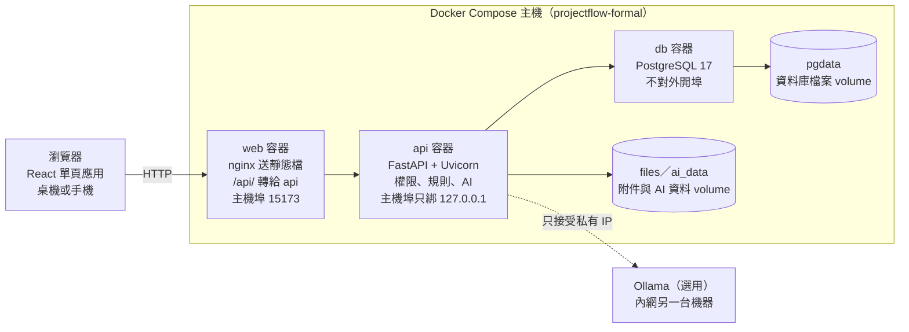
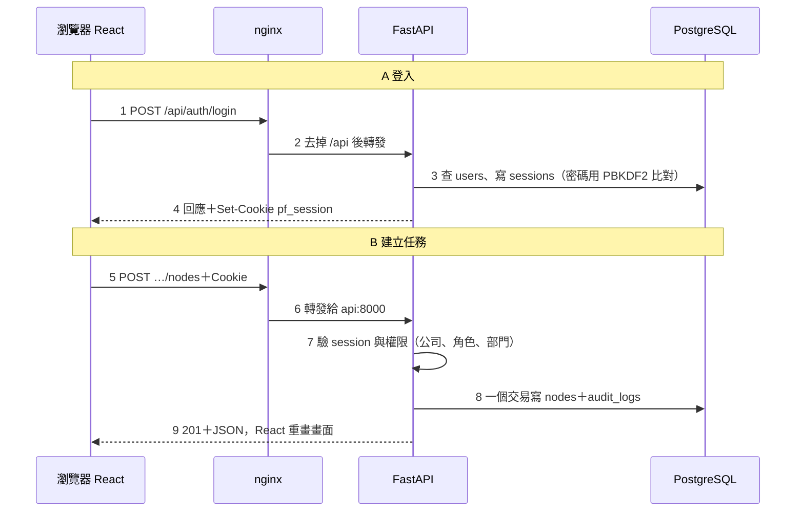

# 專流 ProjectFlow 技術路線圖

2026-10-19 · Liyu

## 總覽

專流是「以專案為中心」的工作流系統：一個專案拆成階段、任務、子任務的樹，任務掛著負責部門、回報、文件、營運資料與 AI 副手。目前已是可試用的正式版（main `28dbecb` 之後），由三個 Docker 容器組成，可在本機、區網或透過 Tailscale 公開試用。

| 項目 | 現況 |
| --- | --- |
| 程式規模 | 後端 23 組 API 路由、約 30 張資料表、19 個 migration；前端約 45 個 React 元件 |
| 測試 | API 約 636 項、前端 Vitest 約 309 項，另有 Playwright 端對端 |
| 展示資料 | 6 家虛構公司、39 專案、約 80 帳號（`deploy/demo-data`） |
| 部署方式 | `docker compose`：db + api + web；區網用 `start.py --lan` |
| 還沒做 | HTTPS 內網正式部署、正式帳號生命週期、備份還原演練、AD/LDAP、ERP 串接 |

## 系統架構

系統是三層式：瀏覽器只和 nginx 講話，nginx 把 `/api/` 開頭的請求轉給 FastAPI，只有 FastAPI 能讀寫 PostgreSQL。

三個容器在 Docker 的內部網路用服務名互相找（`api:8000`、`db:5432`）。對外只開 web 的 15173；加 `--lan` 時才綁到所有網卡，否則只有本機連得到。

## 技術選型與理由

每一層都選主流、文件完整、能在一台筆電跑起來的工具，理由如下。

| 層 | 技術 | 做什麼 | 為什麼選它 |
| --- | --- | --- | --- |
| 前端框架 | React 19 + TypeScript 7 | 畫面與互動（`web/src`） | 元件化、型別檢查擋掉低級錯誤 |
| 前端建置 | Vite 8 | 開發熱更新、打包成靜態檔 `dist/` | 快，設定少 |
| 網頁伺服器 | nginx | 送靜態檔，把 `/api/` 轉給後端 | 前後端同網域，免 CORS；可加主機名檢查 |
| 後端 | FastAPI + Uvicorn（Python 3.13） | REST API、權限、商業規則 | 自動產生文件、型別驗證、Python 生態好接 AI |
| ORM | SQLAlchemy 2 | Python 類別對應資料表（`models.py`） | 不手寫 SQL 也能控制交易 |
| 資料庫 | PostgreSQL 17 | 正式資料 | 交易、外鍵、CHECK 約束可靠 |
| 結構升級 | Alembic | 19 個 migration，一版一版升級 | 不重設資料就能加欄位 |
| AI 副手 | SQLite FTS5 + BM25、可選 Ollama | RAG 文件問答、受控 Text-to-SQL | 不需向量模型；模型可放內網另一台 |
| 密碼 | PBKDF2-SHA256（`security.py`） | 密碼雜湊 | 標準庫內建，無外部相依 |
| 登入狀態 | Session token 存 Cookie、表 `sessions` | 辨識是誰、哪家公司 | 可後端撤銷，前端拿不到 token |
| 容器 | Docker Compose | 三個服務一鍵啟動 | 換一台機器也是同一個環境 |
| 測試 | pytest、Vitest、Playwright | 後端、前端單元、瀏覽器端對端 | 三層各自驗證 |

## 功能地圖

每個功能都是「前端元件 → API 路由 → service 規則 → 資料表」四段，要追一個功能就照這張表的檔名找。路由在 `api/app/routes/`，service 在 `api/app/services/`，元件在 `web/src/components/`。

| 功能 | 使用者看到什麼 | 前端元件 | API 路由 | 主要 service |
| --- | --- | --- | --- | --- |
| 登入與公司隔離 | 公司代碼＋帳號登入、切換公司 | `WorkspaceShell` | `auth` | `auth.py`、`permissions.py` |
| 部門 | 部門與主管設定 | `DepartmentManager` | `departments` | — |
| 專案與任務樹 | 專案總覽、階段卡、子節點 | `WorkspaceOverview`、`NodeWorkspace`、`NodeEditor` | `projects`、`workspace` | `tree_service`、`node_policy`、`progress` |
| 我的待辦 | 本人負責／協作的未完成任務 | `MyTasks` | `workspace` | — |
| 時程 | 日／週／月時程、拖拉日期 | `TimelineView` | `projects` | `schedule_service` |
| 相依與前置 | 相依圖、FS 前置、Gate、條件 | `DependencyGraph`、`DependencyPanel` | `dependencies`、`conditions` | `dependency_service`、`condition_service` |
| 模板與流程 | 另存／套用模板、15 套產業流程 | `TemplateDialogs`、`WorkflowLibrary` | `workflows` | `template_service`、`workflow_service` |
| 回報與審核 | 回報卡、確認／退回、自訂欄位 | `ReportPanel`、`ReviewCenter`、`ReportFieldEditor` | `reports`、`report_fields`、`records` | `report_service`、`record_policy` |
| 協作與通知 | 協作者、協作請求、通知 | `CollaboratorEditor`、`CollaborationDialogs`、`Notifications` | `collaborators`、`collaboration`、`notifications` | `collaboration_service`、`notification_service` |
| 附件與文件 | 上傳下載、版本、配額 | `AttachmentList`、`DocumentManager` | `attachments`、`documents` | `attachment_store`、`document_store` |
| 營運資料 | 供應商、原料、配方、連結任務 | `OperationsManager`、`LinkedOperations` | `operations`、`operation_links` | — |
| 庫存、採購、工單 | 收貨、領料、完工、退貨、沖銷 | `InventoryPanel`、`PurchaseOrderPanel`、`WorkOrderPanel` | `inventory`、`purchasing`、`production` | `stock_service`、`purchase_service`、`work_order_service` |
| 稽核 | 誰在何時做了什麼 | `AuditLogView` | `audit_logs` | `audit.py` |
| AI 副手 | RAG 文件問答、Text-to-SQL、模型設定 | `CopilotPanel`、`ModelSettings` | `ai` | `ai/service.py`、`ai/store.py` |

## 一個請求怎麼走完

登入拿到 Cookie 之後，每個請求都由 API 從 Cookie 找回公司與角色、先驗權限，再用一個交易寫入資料與稽核。

對應程式：步驟 3 在 `routes/auth.py` 的 `/login` 與 `security.py`；步驟 5–8 在 `routes/projects.py` 的 `create_node`，權限由 `Depends(require_session)` 注入。其他功能都是同一個模式。

## 資料模型

所有資料都掛在「公司（organizations）」底下，這是公司隔離的根本；API 從登入 session 決定公司，不接受前端傳來的 company_id。專案是一棵節點（nodes）樹，其他大多數表都掛在節點上。

| 群組 | 資料表 | 關係重點 |
| --- | --- | --- |
| 身分 | `organizations`、`users`、`sessions`、`departments`、`department_members` | 使用者屬於一家公司；部門可有主管 |
| 專案樹 | `projects`、`nodes` | 節點有 parent，形成階段 → 任務 → 子任務；有負責部門、日期、權重、軟刪除 |
| 流程 | `workflows`、`workflow_versions`、`workflow_nodes`、`gates`、`node_dependencies`、`node_conditions` | 模板有版本；相依與 Gate 控制「前一個做完才能開始」 |
| 回報協作 | `task_reports`、`task_notes`、`node_collaborators`、`collaboration_requests`、`notifications` | 回報需審核；協作者可看到非自己部門的節點 |
| 檔案 | `attachments`、`attachment_quotas`、`documents`、`document_versions` | 檔案本體存 volume，資料庫只存資訊與版本 |
| 營運 | `operations_records`、`operation_links`、`inventory_balances`、`inventory_movements`、`purchase_orders`、`purchase_order_lines`、`work_orders` | 庫存以「流水」記帳，沖銷是反向流水、原紀錄保留 |
| 稽核 | `audit_logs` | 重要操作與 AI 查詢摘要都寫入 |

**Migration 怎麼運作**：`api/alembic/versions/` 裡每個檔是一次結構變更（`0001` 核心 → `0019` 退貨與沖銷）。升級時按編號依序執行，舊資料保留；部署前的慣例是先 `pg_dump` 備份。

AI 副手的展示資料不在 PostgreSQL，而是每家公司一個唯讀 SQLite（volume `ai_data`），與正式任務樹分開。

## 部署環節（區網）

區網部署已經內建：`python deploy/start.py --lan` 會把 web 綁到所有網卡，同網段的人用 `http://<這台IP>:15173` 就能用；API 與資料庫仍只在本機。

**`start.py` 實際做的事**

1. 第一次執行時產生 `deploy/.env`（資料庫密碼、`WEB_PORT=15173`、`API_PORT=18000`）。
2. `docker compose up --build`：照 `api.Dockerfile`、`web.Dockerfile` 建映像，啟動 db → api → web（依 healthcheck 等前一個就緒）。
3. `alembic upgrade head`：把資料庫升到最新結構（目前 `0019`）。
4. 加 `--seed-demo` 才寫入範例帳號；平常資料保留。
5. 健檢 `/api/health/ready`，印出本機與區網網址。

**在另一台區網主機從零部署**

1. 安裝 Docker Desktop、Python 3.13、Git，`git clone` repo。
2. `python deploy/start.py` 建空環境，再 `python deploy/demo_data.py import` 還原展示資料（只能匯入同版本的空資料庫）。
3. `python deploy/start.py --lan` 開放區網。
4. 系統管理員 PowerShell 開防火牆：`New-NetFirewallRule -DisplayName 'ProjectFlow 15173 (LAN trial)' -Direction Inbound -Protocol TCP -LocalPort 15173 -RemoteAddress LocalSubnet -Action Allow`。
5. 用 `ipconfig` 確認區網 IP，另一台電腦開 `http://<IP>:15173` 測試登入。
6. 停止對外：不加 `--lan` 再跑一次 `start.py`，並移除防火牆規則。

| 事項 | 現況 | 正式內網前要補 |
| --- | --- | --- |
| HTTPS | 區網是明碼 HTTP | 加 Caddy／內部憑證 |
| 密碼 | 展示帳號密碼是 `demo-<帳號>`，可推得 | 改真密碼、關 `PF_SHOWCASE_MODE` |
| 備份 | 部署前手動 `pg_dump` | 排程每日備份資料庫與 files volume |
| 開機啟動 | 公開試用有捷徑，區網沒有 | 加一個 `--lan` 版開機捷徑 |
| 模型設定 | 只有本機 127.0.0.1 的畫面可設 | 維持，安全設計 |

## 開發流程

開發由 `docs/PROGRESS.md` 看板驅動，規則寫在 `docs/WORKFLOW.md`；目前採「展示優先精簡流程（D81）」，每批一次審查、一次相關回歸。

1. **立項**：看板加一個工作項目（⬜），和人類一起 brainstorming 寫短規格（✏️）。
2. **規劃**：spec 與 plan commit 後變 📋，列出允許修改的檔案與驗收條件。
3. **開分支**：在主 checkout `git checkout -b feature/...`（不用 worktree，D2），狀態 🔨。
4. **逐 Task 實作**：先寫會失敗的測試（RED）→ 實作 → 通過；每個 Task commit `Progress: <WID> task N done`。`/pf-next` 幫你推進一步。
5. **審查**：獨立審查者讀 diff，按嚴重度分級；需要就修正一輪。
6. **驗收**：在隔離的 Compose 跑自動驗收，桌面 1280 與手機 375 都要看。
7. **合併與發布**：`git merge --ff-only` 進 main，依 D50 push（不 force），再部署到 15173。
8. **記錄**：更新 PROGRESS「▶ 現在」的測試基準、資料版本與下一個動作；人類試用簽核不由 AI 代勾。

測試分三層：`api/tests`（pytest，含權限與併發）、`web/src/*.test.tsx`（Vitest，元件行為）、`web/e2e`（Playwright，真瀏覽器配真 PostgreSQL）。

## 里程碑與路線圖

從單檔 Demo 到正式版已走完五個階段；接下來三項在 `docs/formal-feature-roadmap.md` 列為「另外規劃與授權」，沒有固定完工日。

| 狀態 | 階段 | 內容 |
| --- | --- | --- |
| ✅ 已完成 | W1–W3 原型 | 單檔 HTML Demo：部門、回報卡、工作流架構 |
| ✅ 已完成 | P1a–P1c 正式底座 | PostgreSQL、真登入、公司隔離、一鍵啟動 |
| ✅ 已完成 | P2a–P2c 任務核心 | 工作區、回報審核、附件、時程、模板、Gate |
| ✅ 已完成 | UI1–UI5、TP-A–G | Demo 介面對齊、進階排程、相依、協作權限 |
| ✅ 已完成 | F1 營運與試用 | 採購、工單、退貨沖銷、AI 副手、區網與公開試用 |
| ▶ 現在 | 2026-10-19 | OPS-PUBLIC 完成，等待下一步方向 |
| ⬜ 規劃中 | F2 跨頁一致性 | 補齊剩餘 Demo 差距、跨頁行為一致 |
| ⬜ 規劃中 | 正式內網部署 | HTTPS、正式帳號、排程備份與還原演練 |
| ⬜ 規劃中 | 外部整合 | AD／LDAP、ERP 串接、真 LLM 與完整 RAG |

規劃中三項的順序與時程待人類決定。區網部署屬於「正式內網部署」這一格：現在的 `--lan` 是試用級，要變正式就補上一節表格的五項。

## 對外解釋重點

**30 秒版本**：專流把專案拆成任務樹，讓每個任務都有負責部門、前置條件、回報審核和相關的文件與營運資料；前端 React、後端 FastAPI、資料 PostgreSQL，整套用 Docker Compose 一鍵部署，AI 副手用本地檢索和內網模型，資料不出公司。

| 常被問到 | 回答 |
| --- | --- |
| 和 Notion／Jira 差在哪？ | 專案為中心：任務帶部門責任、Gate 與前置，並連到採購、工單、庫存等營運資料 |
| 不同公司的資料會混到嗎？ | 不會。公司由登入 session 決定，每個查詢都帶公司條件，彙總也不洩漏隱藏節點 |
| 權限在哪裡控制？ | 後端（`permissions.py`、`node_policy`、`record_policy`）。前端隱藏按鈕只是體驗，不是安全 |
| 庫存打錯怎麼辦？ | 用「沖銷」新增反向流水，原紀錄保留，可稽核；每筆只能沖銷一次 |
| AI 會亂答或亂跑 SQL 嗎？ | RAG 只用檢索到的文件並附引用；Text-to-SQL 只能選內建的 16 種分析模板，模型不能執行任意 SQL |
| 資料會送到雲端嗎？ | 不會。模型只接受私有 IP 的 Ollama，拒絕公開端點 |
| 怎麼確定沒寫壞？ | 約 950 項自動測試＋每批獨立審查＋隔離環境驗收 |
| 為什麼用 Docker？ | 三個服務、版本、設定都寫在 compose，換機器一個指令就是同樣環境 |
